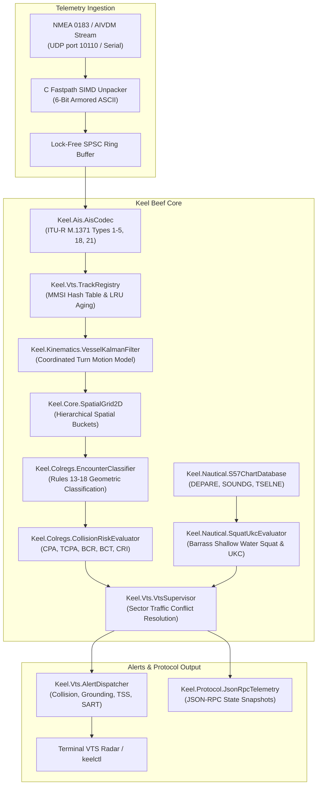

# Keel Architecture Specification

Keel is a high-performance maritime Vessel Traffic Management (VTS) and IMO COLREGs 72 collision avoidance kernel. The engine is designed with Beef as its primary star, paired with a C11 SIMD-accelerated fastpath and Python operational tooling.

---

## 1. System Overview

Commercial vessel traffic operations demand deterministic, zero-garbage-collection throughput to process high-frequency VHF telemetry bursts from hundreds of ships while maintaining real-time safety situational awareness.

---

## 2. Memory Architecture & Concurrency

### 2.1. Linear Arena Allocator
Real-time packet ingestion cannot tolerate garbage collection pauses or thread contention from standard heap allocation. Keel employs a sequential `LinearArena` allocator:
- Memory is acquired in bulk up front via aligned pages.
- Individual allocations advance an internal offset pointer.
- Upon completion of a telemetry processing epoch, the arena is reset in $O(1)$ time by setting the offset pointer to zero.

### 2.2. Fixed-Size Block Pool
Vessel track envelopes and telemetry frames utilize a pre-allocated `FixedBlockPool<T>`:
- Capacity is fixed at initialization time.
- Free slots are tracked via an internal index stack.
- Allocation and deallocation are strictly $O(1)$ without pointer chasing.

### 2.3. Lock-Free SPSC Ring Buffer
Communication between the network ingestion thread and the analysis pipeline is handled by a single-producer single-consumer ring buffer:
- Bounded power-of-two capacity with bitwise index masking (`index = tail & mask`).
- Atomic head and tail indices with memory order acquire/release semantics.
- Zero mutex locking or OS context switching on the fastpath.

---

## 3. Kinematic State Estimation (Extended Kalman Filter)

Each vessel track is filtered by an Extended Kalman Filter tracking a 6-dimensional kinematic state vector in a local East-North-Up (ENU) tangent plane:

$$x = \begin{bmatrix} p_e & p_n & v_e & v_n & \psi & \dot{\psi} \end{bmatrix}^T$$

Where:
- $p_e, p_n$: Local Easting and Northing coordinates in meters relative to a regional tangent origin.
- $v_e, v_n$: Velocity components in meters per second.
- $\psi$: Vessel True Heading in radians.
- $\dot{\psi}$: Rate of Turn (ROT) in radians per second.

### 3.1. Coordinated Turn Motion Model
When a vessel executes a turning maneuver ($\dot{\psi} \neq 0$), linear motion models introduce significant tracking lag. Keel applies the nonlinear coordinated turn equations during the prediction phase:

$$p_e(t + \Delta t) = p_e(t) + \frac{v_e \sin(\dot{\psi} \Delta t) + v_n (\cos(\dot{\psi} \Delta t) - 1)}{\dot{\psi}}$$

$$p_n(t + \Delta t) = p_n(t) + \frac{v_e (1 - \cos(\dot{\psi} \Delta t)) + v_n \sin(\dot{\psi} \Delta t)}{\dot{\psi}}$$

$$v_e(t + \Delta t) = v_e(t) \cos(\dot{\psi} \Delta t) - v_n(t) \sin(\dot{\psi} \Delta t)$$

$$v_n(t + \Delta t) = v_e(t) \sin(\dot{\psi} \Delta t) + v_n(t) \cos(\dot{\psi} \Delta t)$$

### 3.2. Geodetic Coordinate Conversion
Conversions between WGS-84 ellipsoidal coordinates (Latitude $\phi$, Longitude $\lambda$) and the local tangent plane use Vincenty's geodesic formulae, ensuring sub-millimeter positional fidelity across long-range tracking sectors.

---

## 4. 2D Uniform Spatial Grid Index

To eliminate $O(N^2)$ pairwise distance checks across dense waterways with hundreds of ships, Keel organizes the active tracking sector into a 2D spatial grid:
- Grid cell width is configured to 2.0 nautical miles (approx 0.033 degrees).
- Vessels are hashed into grid buckets based on floor coordinates:

$$c_x = \lfloor \lambda / \Delta \lambda \rfloor, \quad c_y = \lfloor \phi / \Delta \phi \rfloor$$

- Pairwise CPA and proximity queries only inspect the 9 adjacent spatial buckets surrounding the target cell, reducing collision search complexity to $O(N)$.
