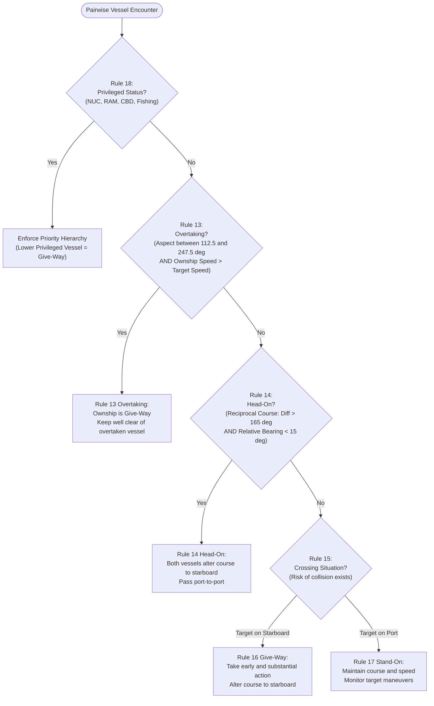

# IMO COLREGs 72 Autonomous Compliance Specification

This document details the mathematical formulation, geometric criteria, and decision-tree logic implemented in Keel to enforce the International Regulations for Preventing Collisions at Sea (IMO COLREGs 1972).

---

## 1. Geometric Encounter Definitions

Let:
- $\mathbf{p}_o = (\phi_o, \lambda_o)$: Ownship geodetic position.
- $\mathbf{p}_t = (\phi_t, \lambda_t)$: Target vessel geodetic position.
- $\psi_o, V_o$: Ownship course over ground and speed.
- $\psi_t, V_t$: Target course over ground and speed.
- $\theta_{brng}$: True initial bearing from ownship to target.

### 1.1. Relative Bearing ($\beta$)
The relative bearing of the target vessel relative to ownship heading is:

$$\beta = (\theta_{brng} - \psi_o) \pmod{360^\circ}$$

Normalized to the interval $[-180^\circ, +180^\circ)$:
- $\beta > 0$: Target is on ownship starboard side.
- $\beta < 0$: Target is on ownship port side.

### 1.2. Target Aspect Angle ($\alpha$)
The aspect angle represents ownship position as viewed from the target vessel heading:

$$\alpha = (\theta_{brng} + 180^\circ - \psi_t) \pmod{360^\circ}$$

---

## 2. Rule-by-Rule Classification Engine

### 2.1. Rule 13: Overtaking
- **Condition**: A vessel is deemed to be overtaking when coming up with another vessel from a direction more than 22.5 degrees abaft her beam ($112.5^\circ < \alpha < 247.5^\circ$), with higher speed ($V_o > V_t$).
- **Obligation**: The overtaking vessel shall keep out of the way of the vessel being overtaken.

### 2.2. Rule 14: Head-on Situation
- **Condition**: When two power-driven vessels are meeting on reciprocal or nearly reciprocal courses so as to involve risk of collision:
  - Course difference: $|\psi_o - \psi_t| > 165^\circ$
  - Relative bearing: $|\beta| < 15^\circ$
- **Obligation**: Each vessel shall alter her course to starboard so that each shall pass on the port side of the other.

### 2.3. Rule 15: Crossing Situation
- **Condition**: When two power-driven vessels are crossing so as to involve risk of collision.
- **Rule 16 (Give-Way Vessel)**: If the other vessel is on ownship starboard side ($5^\circ < \beta \le 112.5^\circ$), ownship shall keep out of the way and avoid crossing ahead of the other vessel. Action shall be early and substantial.
- **Rule 17 (Stand-On Vessel)**: If the other vessel is on ownship port side ($-112.5^\circ \le \beta < -5^\circ$), ownship shall keep her course and speed. If the give-way vessel fails to take appropriate action, the stand-on vessel may take action by her maneuver alone to avoid collision (permissive action).

### 2.4. Rule 18: Responsibilities Between Vessels
A power-driven vessel underway shall keep out of the way of:
1. A vessel not under command (NUC).
2. A vessel restricted in her ability to maneuver (RAM).
3. A vessel engaged in fishing.
4. A sailing vessel.
5. A vessel constrained by her draught (CBD) under Rule 28.

---

## 3. Collision Risk Index (CRI) Formulation

Keel evaluates a composite Collision Risk Index synthesising five domain attributes:

$$\text{CRI} = w_{dcpa} U(D_{cpa}) + w_{tcpa} U(T_{cpa}) + w_d U(D) + w_{enc} U(Enc)$$

Where weights satisfy $\sum w_i = 1.0$:
- $w_{dcpa} = 0.40$
- $w_{tcpa} = 0.35$
- $w_d = 0.15$
- $w_{enc} = 0.10$

Membership functions are defined via smooth cosine-bell transitions:

$$U(D_{cpa}) = \begin{cases} 
1.0 & D_{cpa} \le 0.5 \text{ NM} \\
0.5 \left( 1 + \cos\left( \pi \frac{D_{cpa} - 0.5}{1.5} \right) \right) & 0.5 < D_{cpa} \le 2.0 \text{ NM} \\
0.0 & D_{cpa} > 2.0 \text{ NM}
\end{cases}$$

When $\text{CRI} \ge 0.50$, a Caution alert is dispatched; when $\text{CRI} \ge 0.75$, an Emergency Alarm is raised.
