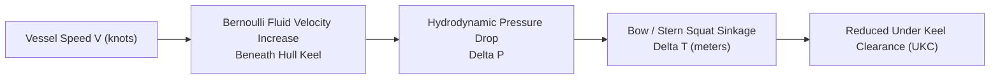

# S-57 Nautical Cartography & Hydrodynamic Squat Specification

This document details the nautical vector cartography model, hydrodynamic squat sinkage equations, and dynamic Under Keel Clearance (UKC) safety margins implemented in Keel.

---

## 1. S-57 Electronic Navigational Chart (ENC) Model

The International Hydrographic Organization (IHO) S-57 standard defines an object-oriented vector model for nautical charts:

### 1.1. Depth Area (`DEPARE`)
- Represents polygon regions bounded by minimum and maximum sounding depth contours (`DRVAL1` and `DRVAL2`).
- Keel indexes depth areas using spatial bounding boxes and evaluates point containment using the Ray-Casting algorithm.

### 1.2. Sounding Point (`SOUNDG`)
- Point features providing surveyed spot depth measurements in meters reduced to the Chart Datum (typically Lowest Astronomical Tide, LAT).

### 1.3. Traffic Separation Scheme (`TSELNE`, `TSEZNE`)
- Bounded one-way traffic routing corridors established by the IMO (e.g. Dover Strait, Singapore Strait, Malacca Strait) to separate opposing flows of shipping.
- Keel validates that vessel courses over ground align within $\pm 90^\circ$ of the designated lane orientation.

---

## 2. Hydrodynamic Squat Effect

When a ship moves through shallow or confined water, the water displaced beneath the hull accelerates. By Bernoulli's principle, this velocity increase causes a local reduction in hydrodynamic pressure, inducing downward bodily sinkage and dynamic trim:

### 2.1. Barrass Squat Formula
Keel computes squat sinkage $\Delta T$ in meters using the empirical Barrass formulation:

$$\Delta T = C_b \frac{V^2}{K}$$

Where:
- $C_b$: Hull block coefficient (typically 0.85 for tankers/bulkers, 0.70 for container vessels, 0.55 for ferries).
- $V$: Vessel speed over ground in knots.
- $K$: Channel confinement constant:
  - $K = 100$ for unrestricted deep open water ($h / T > 2.0$).
  - $K = 75$ for shallow open water ($1.2 < h / T \le 2.0$).
  - $K = 50$ for restricted dredged fairways, canals, and shallow banks.

### 2.2. Heeling Allowance
When a vessel heels during course changes or under wind pressure, the bilge keel dips deeper into the water column. The additional draught allowance is:

$$\Delta T_{heel} = \frac{B}{2} \sin(\theta_{heel})$$

Where $B$ is the vessel beam in meters and $\theta_{heel}$ is the roll/heel angle.

---

## 3. Dynamic Under Keel Clearance (UKC)

The net Under Keel Clearance is the vertical distance between the deepest point of the vessel keel and the seabed:

$$\text{UKC} = (H_{chart} + H_{tide}) - (T_{static} + \Delta T_{squat} + \Delta T_{heel} + M_{wave})$$

Where:
- $H_{chart}$: Charted sounding depth in meters.
- $H_{tide}$: Real-time water level elevation above Chart Datum due to astronomical tides.
- $T_{static}$: Static vessel draught as reported in AIS Type 5 static voyage data.
- $\Delta T_{squat}$: Calculated hydrodynamic squat sinkage.
- $\Delta T_{heel}$: Heeling draught increase.
- $M_{wave}$: Safety allowance for wave-induced pitch and heave motions (typically 0.5 to 1.0 meters).

---

## 4. Grounding Hazard Early Warning

Keel projects vessel position along its current course over ground for a configurable lookahead window (default 1200 seconds / 20 minutes).

Points are sampled every 100 meters along the geodesic track. If any sample point falls within an S-57 depth area where the maximum depth is less than the required dynamic safety depth:

$$D_{safety} = T_{static} + \Delta T_{squat} + \text{Margin}_{policy} - H_{tide}$$

An Emergency Grounding Alarm is immediately raised, providing distance to the shallow contour, time to impact, and sounding depth.
